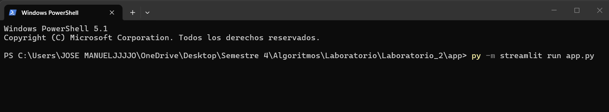
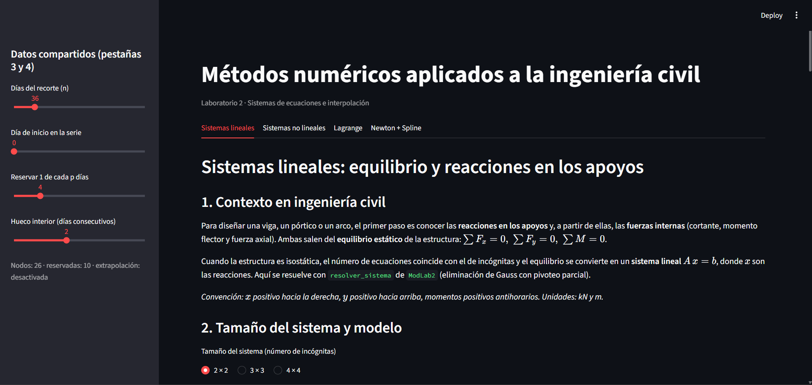
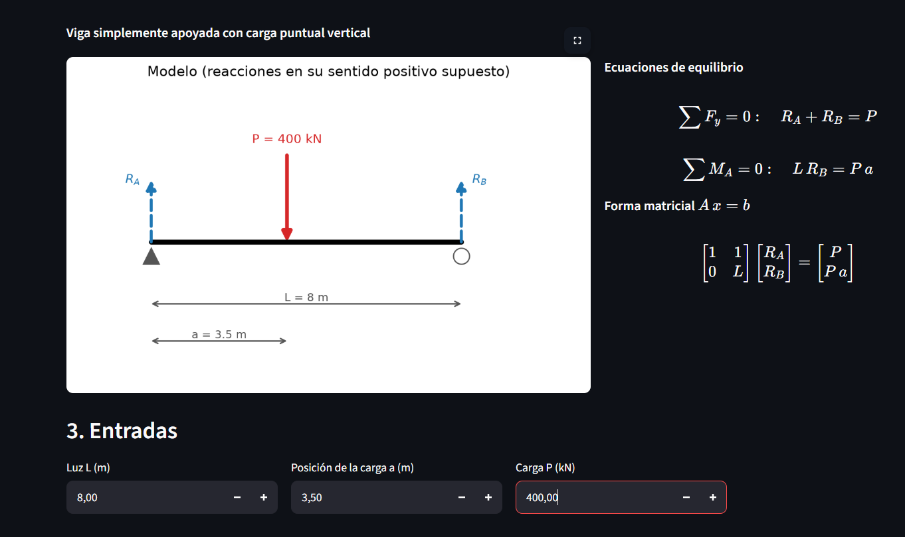
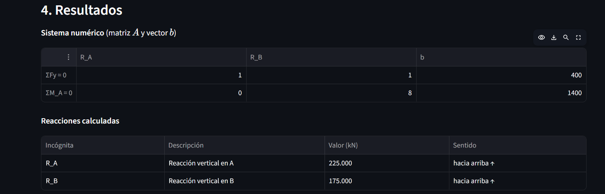
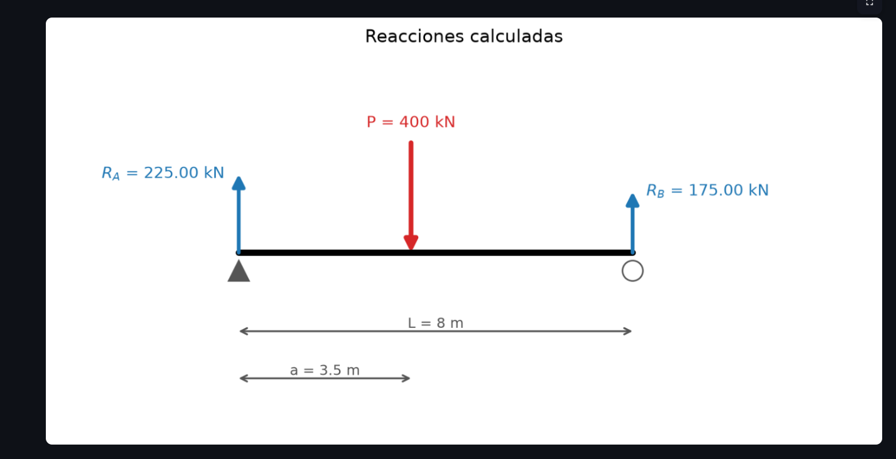
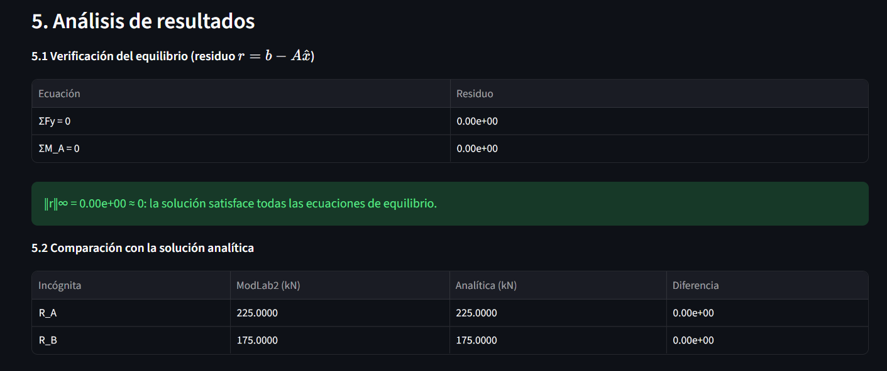
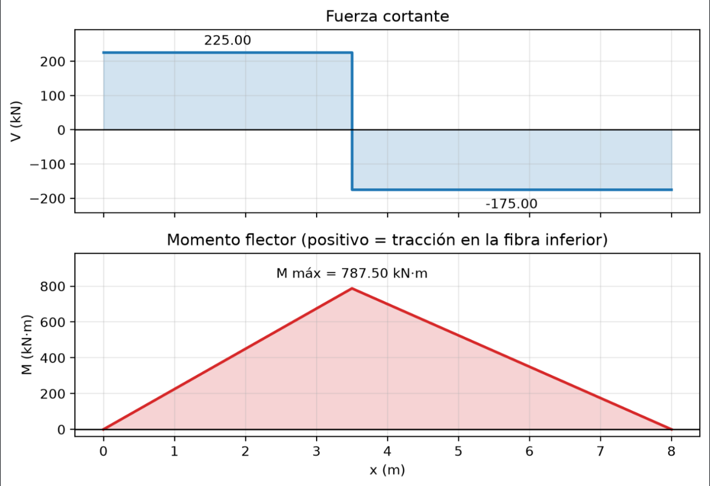

# Informe Laboratorio 2 - Workshop 02: Sistemas de Ecuaciones e Interpolación

# Integrantes:
  **Jose Manuel Arboleda Carvajal** \\
  **Gabriel David Castaño**

# Docente:
  **Mario Hernan Lopez Arbelaez**

# Asignatura:
  **Algoritmos numéricos**

# Intitución:
 **Universidad del Quindío** \\
 **Faculdad de Ingeniería** \\
 **Programa de Ingeniería Civil**

# Fecha:
  **3 de noviembre de 2026**

## Introducción

En el presente informe se describen los métodos empleados para resolver los ejercicios del Workshop 02, abordando sistemas de ecuaciones lineales y no lineales, así como los interpoladores de Lagrange y Newton. Asimismo, se analiza la importancia de las tolerancias, el residuo, el control de las actualizaciones en métodos iterativos y los criterios de convergencia como elementos fundamentales para interpretar y evaluar la precisión de las soluciones obtenidas.

Adicionalmente, se presenta una breve descripción del desarrollo de la aplicación web, explicando cómo se implementan los métodos numéricos y su aplicación en diferentes contextos de la ingeniería civil. Se destacan sus ventajas para resolver problemas de manera eficiente y precisa, proporcionando ejemplos relacionados con los ejercicios planteados en la guía del Workshop 02.

Se destaca que la implementación modular permitió mantener una estructura organizada durante el desarrollo de la aplicación, simplificando el proceso de programación y facilitando la creación de una herramienta funcional y eficiente.

También se incluye un análisis del uso de la inteligencia artificial durante el desarrollo del Workshop 02, especificando sus aplicaciones, su utilidad en el proceso de elaboración y las reflexiones individuales de cada integrante sobre su experiencia y aprovechamiento.

Finalmente, se presenta un ejemplo de ejecución de la aplicación web, mostrando ejercicios previamente seleccionados y los resultados obtenidos.

---

## Distribución de responsabilidades

- **Integrante A:** Yo asumí el bloque de sistemas de ecuaciones lineales y no lineales y la interpretación de elementos que conforman estos ejercicios, esto comprendió:

* La programación del módulo `ModLab2`.
* La redacción y ejecución de los cuadernos 1 y 2.
* El diseño de las pestañas 1 y 2 en Streamlit.
* El registro del uso de la IA ára estos apartados.

- **Integrante B:** Por mi parte, asumí el bloque de interpolación y análisis de datos reales, lo que comprendió:

* La programación de los módulos `interpolacion.py`, `datos.py` y `metricas.py`.
* La redacción y ejecución de los cuadernos 3, 4 y 5.
* El diseño de las pestañas 3 y 4 en Streamlit.
* El registro del uso de IA para estos apartados.

Asimismo, cumpliendo con la exigencia metodológica individual de la guía, resolví a mano doce ejercicios correspondientes a las cuatro clases del módulo (sistemas lineales, sistemas no lineales, Lagrange y Newton/Spline). La formulación del proyecto y la integración de los entregables se unificaron en el repositorio del equipo.

---

## Sistemas lineales

Uno de los puntos principales dentro del Workshop 02 es resolver ejercicios manualmente, en este espacio se explica como se llevaron a cabo los ejercicios de sistemas lineales, resolviendo ecuaciones de tamaño $2 \times 2,\quad 3 \times 3 \quad$ y $\quad 4 \times 4$, aplicando distintos métodos vistos en clase.

### Sistemas $2 \times 2$:

En el análisis de los sistemas $2 \times 2$, las soluciones a dichos sistemas se determinaron con métodos simples, como el de sustitución, este consiste en despejar una incógnita de una de las dos ecuaciones, reemplazarla en la ecuación restante, aplicar operaciones simples para determinar el valor de una incógnita, reemplazar ese valor hallado en cualquiera de las ecuaciones y determinar la incógnita restante. Para contextualizar mejor este procedimiento, se mostrará su uso en el siguiente ejemplo:

Considerando el sistema de ecuaciones lineales hecho manualmente:

$$
\begin{cases}
2x + 3y = 11 \quad \text{--- (Ecuación 1)} \\
4x + y = 14 \quad \text{--- (Ecuación 2)}
\end{cases}
$$

#### **Paso 1: Despejar una variable**
Elegimos la variable más sencilla de despejar. En este caso, despejamos $y$ en la **Ecuación 2**:

$$
4x + y = 14 \implies y = 14 - 4x \quad \text{--- (Ecuación 3)}
$$

#### **Paso 2: Sustituir la variable despejada**
Sustituimos la expresión de $y$ (Ecuación 3) en la **Ecuación 1**:

$$
2x + 3(14 - 4x) = 11
$$

#### **Paso 3: Resolver la ecuación lineal resultante**
Desarrollamos y agrupamos términos semejantes para encontrar el valor de $x$:

$$
\begin{aligned}
2x + 42 - 12x &= 11 \\
-10x + 42 &= 11 \\
-10x &= 11 - 42 \\
-10x &= -31 \\
x &= \frac{-31}{-10} \implies \mathbf{x = \frac{31}{10}}
\end{aligned}
$$

#### **Paso 4: Encontrar la segunda variable**
Sustituimos el valor hallado $x = \frac{31}{10}$ en la **Ecuación 3** (la que ya teníamos despejada):

$$
y = 14 - 4(\frac{31}{10}) \implies y = 14 - \frac{62}{5} \implies \mathbf{y = \frac{8}{5}} 
$$

#### **Paso 5: Verificación del resultado**
Comprobamos que el punto $(x, y) = (\frac{31}{10}, \frac{8}{5})$ satisface ambas ecuaciones originales:

* **Ecuación 1:** $2(\frac{31}{10}) + 3(\frac{8}{5}) = \frac{31}{5} + \frac{24}{5} = 11 \quad \checkmark$
* **Ecuación 2:** $4(\frac{31}{10}) + (\frac{8}{5}) = \frac{62}{5} + \frac{8}{5} = 14 \quad \checkmark$

**Solución del sistema:**

$$
\mathbf{(x, y) = (\frac{31}{10}, \frac{8}{5})}
$$

Este sistema se destaca por ser sencillo de resolver, ya que no necesita más que operaciones simples (despejes, suma, resta, multiplicación o división) para ser resuelto.

---

### Sistemas $3 \times 3$

Para los sistemas $3 \times 3$ existen diversos métodos para encontrar sus soluciones, uno de ellos es el método de cofactores implementando la regla de Cramer, este consisite en calcular el determinante de una matriz, luego se reemplaza el vector de valores independientes por la columna respectiva para hallar la incognita deseada,para $x$ se reemplaza la columna 1, para $y$ la columna 2 y para $z$ la columna 3, se calcula determianante de la nueva matriz generada y se divide entre el determinante de la matriz original previamente calculado, esto se explica detalladamente a continuación:    

$$
\begin{bmatrix}
a_{11} & a_{12} & \cdots & a_{1n} \\
a_{21} & a_{22} & \cdots & a_{2n} \\
\vdots & \vdots & \ddots & \vdots \\
a_{n1} & a_{n2} & \cdots & a_{nn}
\end{bmatrix}
\begin{bmatrix}
x_1 \\
x_2 \\
\vdots \\
x_n
\end{bmatrix}
= \begin{bmatrix}
b_1 \\
b_2 \\
\vdots \\
b_n
\end{bmatrix}
$$

El valor de cada incógnita $x_i$ se calcula como la razón de dos determinantes:

$$
x_i = \frac{\det(A_i)}{\det(A)}
$$

Donde $A_i$ es la matriz formada al reemplazar la $i$-ésima columna de la matriz $A$ por el vector de términos independientes $\mathbf{b}$:

$$
A_i = 
\begin{bmatrix}
a_{11} & \cdots & b_1 & \cdots & a_{1n} \\
a_{21} & \cdots & b_2 & \cdots & a_{2n} \\
\vdots & \ddots & \vdots & \ddots & \vdots \\
a_{n1} & \cdots & b_n & \cdots & a_{nn}
\end{bmatrix}
$$

**Ejemplo para un sistema $3 \times 3$:**

$$
x_1 = \frac{\begin{vmatrix} b_1 & a_{12} & a_{13} \\ b_2 & a_{22} & a_{23} \\ b_3 & a_{32} & a_{33} \end{vmatrix}}{\det(A)}, \quad
x_2 = \frac{\begin{vmatrix} a_{11} & b_1 & a_{13} \\ a_{21} & b_2 & a_{23} \\ a_{31} & b_3 & a_{33} \end{vmatrix}}{\det(A)}, \quad
x_3 = \frac{\begin{vmatrix} a_{11} & a_{12} & b_1 \\ a_{21} & a_{22} & b_2 \\ a_{31} & a_{32} & b_3 \end{vmatrix}}{\det(A)}
$$

Este método fue empleado para resolver uno de los ejercicios realizados manualmente, se observo que este método es un poco más extenso que el anterior, sin embargo, también se destaca por su sencillez a la hora de resolverlo, si se tiene buen conocimiento del cálculo de determinantes, o se cuenta con un software que pueda realizarlo, es sencillo llegar las soluciones del sistema.

---

### Sistemas $4 \times 4$:

Para los sistemas $4 \times 4$ el cálculo de sus soluciones se vuelve más complejo, ya que los métodos vistos anterioremente son más difíciles de aplicar o directamente no se pueden hacer, como los métodos de cofactores con regla de Cramer y sustitución respectivamente.

Para dar solución a estos sistemas existe el método de reducción Guss-Jordan, este consisite en igualar la matriz de coeficientes e igularla al vector de variables independientes, reducir la matriz de coeficientes a la matriz identidad mediante operaciones elementales (suma, resta, multiplicación o división) entre sus filas, luego se comparan con los valores obtenidos en el vector de variables independientes, los cuales serán las soluciones del sistema, como se ve a continuación:

Dado el sistema de ecuaciones $4 \times 4$:

$$
\begin{bmatrix}
a_{11} & a_{12} & a_{13} & a_{14} & \mid & b_1 \\
a_{21} & a_{22} & a_{23} & a_{24} & \mid & b_2 \\
a_{31} & a_{32} & a_{33} & a_{34} & \mid & b_3 \\
a_{41} & a_{42} & a_{43} & a_{44} & \mid & b_4
\end{bmatrix}
$$

**Estructura Algorítmica (Paso a Paso)**

1. **Pivote 1 ($a_{11}$):**
   * Se normaliza la Fila 1 dividiendo por el pivote: $F_1 \to \frac{F_1}{a_{11}}$.
   * Se hacen cero todos los elementos debajo de $a_{11}$ en la Columna 1:
     $$F_i \to F_i - a_{i1} F_1 \quad \text{para } i = 2, 3, 4$$

2. **Pivote 2 ($a_{22}$):**
   * Se normaliza la Fila 2 dividiendo por el nuevo pivote: $F_2 \to \frac{F_2}{a_{22}}$.
   * Se hacen cero los elementos por encima y por debajo de $a_{22}$ en la Columna 2:
     $$F_i \to F_i - a_{i2} F_2 \quad \text{para } i = 1, 3, 4$$

3. **Pivote 3 ($a_{33}$):**
   * Se normaliza la Fila 3: $F_3 \to \frac{F_3}{a_{33}}$.
   * Se hacen cero los elementos restantes de la Columna 3:
     $$F_i \to F_i - a_{i3} F_3 \quad \text{para } i = 1, 2, 4$$

4. **Pivote 4 ($a_{44}$):**
   * Se normaliza la Fila 4: $F_4 \to \frac{F_4}{a_{44}}$.
   * Se hacen cero los elementos por encima de $a_{44}$ en la Columna 4:
     $$F_i \to F_i - a_{i4} F_4 \quad \text{para } i = 1, 2, 3$$

**Forma Matricial Final**

Al finalizar las operaciones de eliminación, el sistema adopta la siguiente forma reducida:

$$
\begin{bmatrix}
1 & 0 & 0 & 0 & \mid & x_1 \\
0 & 1 & 0 & 0 & \mid & x_2 \\
0 & 0 & 1 & 0 & \mid & x_3 \\
0 & 0 & 0 & 1 & \mid & x_4
\end{bmatrix}
$$

Donde los valores del vector solución se leen de forma directa sin necesidad de sustitución hacia atrás:

$$
\mathbf{x} = \begin{bmatrix} x_1 \\ x_2 \\ x_3 \\ x_4 \end{bmatrix}
$$

El método de reducción Gauss-Jordan se aplicó para resolver varios ejercicios manualmente, se observó que este método es un poco estenso, ya que para algunos fue necesario hacer más de 15 operaciones elementales, este llega a ser más complejo ya que se debe tener mucho cuidado con que operacios aplicar a las filas, pero se destaca por su confiabilidad y presición para hallar las soluciones de sistmeas de ecuaciones complejos. 

---

## Sistemas no lineales

Los métodos numéricos para resolver sistemas no lineales son procedimientos iterativos que permiten encontrar soluciones aproximadas a sistemas en los que las variables están relacionadas mediante funciones no lineales. Estos métodos generan sucesivas aproximaciones hasta alcanzar un nivel de precisión establecido mediante una tolerancia.

Al igual que en los sistemas lineales, existen diversos métodos para resolver sistemas de ecuaciones no lineales, destacando Newton-Raphson y Punto Fijo, los cuales se emplearon para solucionar manualmente ejercicios de sistemas de dimensiones $2 \times 2,\quad 3 \times 3 \quad$ y $\quad 4 \times 4$. 

### Newton-Raphson:

Este método emplea las derivadas de las funciones del sistema para calcular nuevas aproximaciones a partir de valores iniciales, buscando reducir el error hasta cumplir cun una tolerancia hasta llegar a la solución con la precisión deseada. Este proceso se explica de mejor manera a continuación:

**Resumen del proceso en 3 Pasos**

1. **Linealización Local mediante Series de Taylor:** 
   Debido a la complejidad analítica de las superficies no lineales, el método aproxima localmente el sistema de funciones en la vecindad del punto iterativo actual $\mathbf{x}^{(k)}$. Se utiliza una expansión en Serie de Taylor multivariable truncada en su término de primer orden, sustituyendo el sistema curvo por un plano tangente hiperbólico.

2. **Operador de Cambio: La Matriz Jacobiana ($J$):** 
   La matriz Jacobiana actúa como el operador diferencial del sistema. Representa la transformación de derivadas parciales de primer orden, definiendo la dirección de máxima pendiente y la sensibilidad de cada ecuación respecto al cambio en las variables independientes.

3. **Corrección Vectorial e Iteración:** 
   Se resuelve el sistema lineal generado para determinar el vector de desplazamiento o incremento $\Delta \mathbf{x}^{(k)}$. Este vector ajusta la aproximación actual proyectándola hacia la intersección de los planos tangentes. El proceso se repite sucesivamente mediante la relación de recurrencia $\mathbf{x}^{(k+1)} = \mathbf{x}^{(k)} + \Delta \mathbf{x}^{(k)}$ hasta alcanzar la convergencia numérica según la tolerancia especificada.

**Esquema del Proceso**

$$
\text{Punto Nuevo} = \text{Punto Actual} + \text{Paso de Corrección}
$$

$$
\begin{bmatrix} x_{k+1} \\ y_{k+1} \end{bmatrix} = \begin{bmatrix} x_k \\ y_k \end{bmatrix} + \begin{bmatrix} \Delta x \\ \Delta y \end{bmatrix}
$$

**Pasos para resolver un ejercicio en la práctica**

**Paso 1: Armar la Jacobiana $J(x, y)$.** Derivar cada función respecto a cada variable:

$$
J(x, y) = \begin{bmatrix} \dfrac{\partial f_1}{\partial x} & \dfrac{\partial f_1}{\partial y} \ \dfrac{\partial f_2}{\partial x} & \dfrac{\partial f_2}{\partial y} \end{bmatrix}
$$

**Paso 2: Evaluar en el punto actual.** Reemplazar las coordenadas de tu punto inicial $(x_0, y_0)$ en las funciones $f_1, f_2$ y en la matriz Jacobiana $J$.

**Paso 3: Encontrar los incrementos $(\Delta x, \Delta y)$.** Resolver el sistema de ecuaciones lineales:

$$
J \cdot \begin{bmatrix} \Delta x \\ \Delta y \end{bmatrix} = - \begin{bmatrix} f_1 \\ f_2 \end{bmatrix}
$$

**Paso 4: Actualizar y repetir.** Sumar los incrementos al punto anterior para obtener $(x_1, y_1)$. Si los incrementos son casi cero (menores a una tolerancia establecida), el método se detiene, ya que ha encontrado una solución.

El método de Newton-Raphson destaca por su rápida convergencia, cuando se realizaron los ejercicios manuales, se pudo observar que este método cumplió con la tolerancia en una iteración, máximo dos, aunque esto no se pueda asegurar que esto sea igual para todos los casos.

### Punto fijo:

Este método transforma las ecuaciones del sistema en expresiones donde las variables dependen de si mismas, al igual que Newton-Raphson, este utiliza valores inciales para calcular sucesivas aproximaciones hasta que los cambios entre iteraciones cumplan con un criterio de parada establecido.

En este método se realizan despejes de las incógnitas de las funciones según el tamaño del sistema, luego se derivan parcialmente estos despejes, se evaluan los valores iniciales y se hace su criterio de convergencia, esto se explica mejor a continuación:

**1. Estructura General de Despejes**

Dado el sistema original de $n$ ecuaciones no lineales:

$$
\begin{cases}
f_1(x_1, x_2, \dots, x_n) = 0 \\
f_2(x_1, x_2, \dots, x_n) = 0 \\
\quad \vdots \\
f_n(x_1, x_2, \dots, x_n) = 0
\end{cases}
$$

Se despeja la variable $x_i$ de la $i$-ésima ecuación para construir las **funciones de iteración** $g_i$:

$$
\begin{aligned}
\text{De } f_1(x_1, x_2, \dots, x_n) = 0 &\implies x_1 = g_1(x_1, x_2, \dots, x_n) \\
\text{De } f_2(x_1, x_2, \dots, x_n) = 0 &\implies x_2 = g_2(x_1, x_2, \dots, x_n) \\
&\ \ \vdots \\
\text{De } f_n(x_1, x_2, \dots, x_n) = 0 &\implies x_n = g_n(x_1, x_2, \dots, x_n)
\end{aligned}
$$

El esquema iterativo de evaluación adopta la forma:

$$
\begin{aligned}
x_1^{(k+1)} &= g_1(x_1^{(k)}, x_2^{(k)}, \dots, x_n^{(k)}) \\
x_2^{(k+1)} &= g_2(x_1^{(k)}, x_2^{(k)}, \dots, x_n^{(k)}) \\
&\ \ \vdots \\
x_n^{(k+1)} &= g_n(x_1^{(k)}, x_2^{(k)}, \dots, x_n^{(k)})
\end{aligned}
$$

**2. Criterio de Evaluación de Convergencia**

La convergencia del método depende directamente de la elección de las funciones de despeje $g_i$. Para garantizar que el proceso iterativo converja hacia la solución, la suma del valor absoluto de las derivadas parciales de cada función debe ser estrictamente menor a 1 en la vecindad del punto evaluado:

$$
\sum_{j=1}^{n} \left| \frac{\partial g_i}{\partial x_j} \right| < 1 \quad \text{para todo } i = 1, 2, \dots, n
$$

**3. Caso Particular: Sistemas $2 \times 2$**

Para un sistema no lineal bidimensional de variables $(x, y)$:

$$
\begin{cases}
f_1(x, y) = 0 \implies x = g_1(x, y) \\
f_2(x, y) = 0 \implies y = g_2(x, y)
\end{cases}
$$

**Esquema Iterativo:**

$$
\begin{cases}
x_{k+1} = g_1(x_k, y_k) \\
y_{k+1} = g_2(x_k, y_k)
\end{cases}
$$

**Condiciones de Convergencia:**

$$
\left| \frac{\partial g_1}{\partial x} \right| + \left| \frac{\partial g_1}{\partial y} \right| < 1
$$

$$
\text{y}
$$

$$
\left| \frac{\partial g_2}{\partial x} \right| + \left| \frac{\partial g_2}{\partial y} \right| < 1
$$

Este se destaca por simplicidad de implementación, realizando los ejercicios se notó que este es más extenso a comparación del método de Newton-Raphson, pero esto se compensa con facilidad para entenderlo, ya que solo se necesita hacer los depejes y las derivadas una sola vez, luego se evalúan los valores iniciales, se observa que función cumple con el criterio de convergencia, actualizar los valores y repetir el proceso hasta cumplir con la tolerancia establecida.

### Control de actualizaciones

Algo importante a destacar en estos métodos es el control de actualizaciones, esto hace referencia al cambio de valores ingresados para calcular las aproximaciones, su control es esencial para supervisar los cambios de las variables en cada iteración y determinar si las aproximaciones están convergiendo hacia una solución. Su importancia radica en que permite evaluar la estabilidad del procedimiento, detectar posibles divergencias y establecer cuándo se ha alcanzado una precisión aceptable. De esta manera, se evitan iteraciones innecesarias y se mejora la confiabilidad de los resultados numéricos.

---

### Análisis del residuo $Ax - b$

El residuo $Ax - b$ (denotado matemáticamente como $\mathbf{r}$) es un vector que mide el error o la diferencia entre una solución aproximada y la solución exacta de un sistema de ecuaciones lineales de la forma $Ax = b$.

En términos prácticos, cunado se intenta resolver un sistema mediante métodos numéricos o aproximados (como Gauss-Seidel o Gauss-Jordan con decimales), es común que no se encuentren los valores precisos de las incógnitas debido a errores de aproximación o truncamiento. El residuo cuantifica que tan lejos está la respuesta correcta.

Este permite verificar la calidad de las soluciones obtenidas, identificando errores en los cálculos, facilitando el control de la presición.

Este tiene diversas aplicaciones, como se explicó anteriormente, este es utilizado en el método de Gauss-Seidel y Gauss-Jordan con decimales, mientras que en la ingeniería civil se aplica en muchas situaciones donde se necesita comprobar la confiabilidad del análisis numérico, donde se destaca su uso en el análisis estructural.

Este se agregó dentro de la aplicación, en la pestaña de sistemas no lineales para dar un criterio de confianza para los calculos realizados por el programa. 

---

## Los datos

Para la aplicación práctica utilicé el caudal medio diario (parámetro 00060, estadístico 00003, en $\text{ft}^3/\text{s}$) de la estación USGS 01646500 (Potomac River near Washington, DC) para el año 2025, consultado el 2 de noviembre de 2026 mediante el servicio Daily Values de NWIS.

Los registros se guardaron sin alterar en `data/usgs_caudal_diario.rdb`, su versión procesada en `data/usgs_procesado.csv` y el registro de exclusiones en `data/usgs_valores_excluidos.csv`. De los 365 días del año, tres registros (15, 16 y 17 de marzo) tenían código Eqp por falla de equipo, por lo que se descartaron sin rellenar artificialmente; se conservó un valor provisional (código P, 10 de junio). Tras la depuración, obtuvimos 362 días válidos, con una mediana de $13,027\,\text{ft}^3/\text{s}$ y un rango entre $4,017$ y $52,100\,\text{ft}^3/\text{s}$.

**Nota de control de calidad:** El script programado (`datos.control_calidad`) identificó tres anomalías en el archivo local de la carpeta `data/`:

1. El 80% de las segundas diferencias es casi constante (mostrando un comportamiento de rampas cuadráticas perfectas con reinicios periódicos, atípico en una serie hidrológica natural).
2. Los valores tienen decimales (p. ej., $5,451.5\,\text{ft}^3/\text{s}$), a diferencia del estándar del USGS que publica cifras enteras o con tres cifras significativas.
3. El encabezado del archivo electrónico indica «UPPER DAMSITE», mientras que la estación oficial es «LITTLE FALLS PUMP STA».

Por lo anterior, es necesario contrastar los datos con la fuente oficial en `waterdata.usgs.gov`. Las cifras de este informe reflejan el comportamiento numérico de los algoritmos sobre el archivo base disponible y no deben tomarse como conclusiones hidrológicas definitivas hasta actualizar el archivo y reejecutar `python reporte_resultados.py`.

---

## Ejercicios manuales

Resolví los doce ejercicios a mano antes de compararlos con los códigos de verificación. Las hojas escaneadas están en el Anexo D. La tabla resume los desarrollos y las correcciones encontradas:

| Clase / Ej. | Enunciado / Descripción | Resultado a mano | Qué corregí / comprobé |
| :--- | :--- | :--- | :--- |
| **07. Lineales** 1 | $3 \times 3$: $2y + 3z = 8$ $4x + 6y + 7z = -3$ $2x + y + 6z = 5$ | $z = 29/11 \approx 2.636$ $y = 1/22$ $x = -239/44 \approx -5.431$ | El pivote en $F_1$ era cero, así que hice un intercambio $F_1 \leftrightarrow F_2$. La sustitución cierra correctamente. |
| **07. Lineales** 2 | $2 \times 2$: $3x + 2y = 7$ $x - 4y = -7$ | $x = 1$, $y = 2$ | No requirió intercambio de filas. |
| **07. Lineales** 3 | Sistema $4 \times 4$ con matriz aumentada | $x_4 = 2$ $x_3 = -13/9$ $x_2 = 46/9$ $x_1 = -41/18$ | Había anotado 2.27777 a mano; el valor correcto redondeado por truncamiento es 2.27778. |
| **08. No lineales** 4 | Newton para sistemas $x_0 = (1.5, 3.5)$ $F_1 = x^2 + xy - 10$ $F_2 = y + 3xy^2 - 57$ | $1^\text{a}$ iteración: A mano dio $(2.03528, 2.84377)$ El código dio $(2.03603, 2.84388)$ | Al revisar, había arrastrado $\Delta y = -0.65623$ en vez de $0.65613$ al dividir. Corregido. |
| **08. No lineales** 5 | Punto fijo desde $(0.5, 0.5)$ $x = (y+1)/3$ $y = (x^2+1)/4$ | $(0.5, 0.3125) \to (0.4375, 0.3125) \to (0.4375, 0.2978515625)$ | Había escrito mal el denominador de $g_2$ en mis notas a mano, pero evalué bien con 4. |
| **08. No lineales** 6 | Sistema $2x - y^2 = 0$ $x - 3y + 2 = 0$ $(x = y^2/2, y = (x+2)/3)$ | Evalué $\rho(J_g)$ en $(1, 1)$ obteniendo $0.57735$ | El punto $(1, 1)$ no es solución del sistema. En las raíces reales se obtiene $\rho = 0.5046$ en $(0.2918, 0.7639)$ y $1.3212$ en $(13.708, 5.236)$. |
| **09. Lagrange** 7 | 3 nodos: $(1, 2), (3, 6), (4, 24)$ evaluar en $x = 2$ | $P(x) = \frac{16}{3}x^2 - \frac{58}{3}x + 16$; $P(2) = -4/3$ | Un punto interior arrojó valor negativo a partir de datos positivos, ilustrando que el polinomio global no garantiza positividad. |
| **09. Lagrange** 8 | 2 nodos: $(2, 5), (5, 11)$ evaluar en $x = 3$ | $P(x) = 2x + 1$; $P(3) = 7$ | Verificado como caso base de interpolación lineal. |
| **09. Lagrange** 9 | 4 nodos: $(0, 1), (1, 2), (2, 5), (3, 10)$ base $L_1$ | $P_3(1) = 2 = y_1$ | Comprobé que la función base $L_1$ toma valor 1 en su nodo y 0 en los demás. |
| **10. Newton** 10 | Diferencias divididas con $(1, 1), (2, 4), (3, 9)$ | Coeficientes: $1, 3, 1$; $P(x) = x^2$ | Se corroboró que los puntos provienen de una función cuadrática exacta. |
| **10. Newton** 11 | Agregar nodo $(4, 16)$ al caso anterior | $f[x_0, \dots, x_3] = 0$; $P_3(x) = x^2$ | Los primeros tres coeficientes se conservan y el nuevo coeficiente resulta cero al ser una parábola exacta. |
| **10. Spline** 12 | Spline natural por analítico $(0, 0), (1, 1), (2, 0)$ | $M_0 = M_2 = 0$; $M_1 = -3$; $S_0(x) = -\frac{1}{2}x^3 + \frac{3}{2}x$ | Ejercicio base del cuaderno 5. |

---

## Métodos y módulos de programación

El polinomio de Lagrange se define como:

$$P(x) = \sum_{i=0}^{n} y_i L_i(x), \quad L_i(x) = \prod_{j \neq i} \frac{x - x_j}{x_i - x_j}$$

Gracias a la propiedad de Kronecker ($L_i(x_j) = \delta_{ij}$) reproduce exactamente los nodos. Por su parte, la forma de Newton mediante diferencias divididas es:

$$P(x) = f[x_0] + \sum_{k=1}^{n} f[x_0, \dots, x_k] \prod_{j=0}^{k-1} (x - x_j)$$

Esto facilita añadir nuevos nodos sin recalcular todo. Como el polinomio interpolador es único, ambos métodos dan resultados idénticos salvo por errores de redondeo. En cuanto al spline cúbico natural, construye tramos cúbicos con continuidad $C^2$ y curvatura nula en los extremos ($M_0 = M_n = 0$), resolviendo un sistema tridiagonal (visto en el Ej. 12).

Los algoritmos se organizaron en tres módulos de Python:

* `interpolacion.py`: Funciones para Lagrange, diferencias divididas de Newton, inserción de nodos, spline cúbico natural y su contraste con `scipy.interpolate.CubicSpline`.
* `datos.py`: Lectura del archivo RDB, control de calidad, partición de datos y series de comparación.
* `metricas.py`: Cálculo de indicadores de error.

Para evitar problemas de condicionamiento en grados altos, normalizamos el tiempo a $[0, 1]$. Definiendo $e_i = \hat{y}_i - y_i$ evaluamos el MAE, el RMSE y el error máximo ($E_{\max}$) en $\text{ft}^3/\text{s}$.

---

## Resultados y comparaciones numéricas

Tomamos un recorte de 36 días (1 de enero al 5 de febrero de 2025), fijando los extremos y reservando puntos intermedios: 26 nodos de construcción y 10 observaciones reservadas (días 2, 6, 10, 14, 17, 18, 22, 26, 30 y 34). Los errores sobre estas observaciones se resumen en la tabla:

| Método | MAE ($\text{ft}^3/\text{s}$) | RMSE ($\text{ft}^3/\text{s}$) | $E_{\max}$ ($\text{ft}^3/\text{s}$) |
| :--- | :--- | :--- | :--- |
| Lagrange global (grado 25) | 3,338,585.4 | 10,167,782.6 | 32,131,292.1 |
| Newton global | 3,338,585.4 | 10,167,782.6 | 32,131,292.1 |
| Spline natural (propio) | 347.2 | 544.8 | 1,375.2 |
| Spline natural (SciPy) | 347.2 | 544.8 | 1,375.2 |
| Lagrange local (2 nodos) | 138.4 | 435.1 | 1,375.9 |
| Lagrange local (3 nodos) | 183.4 | 410.0 | 916.8 |
| Lagrange local (4 nodos) | 297.9 | 527.6 | 1,375.1 |

El residual en los nodos fue 0 para Lagrange, del orden de $2 \times 10^{-12}$ para el spline y $1.44 \times 10^{-3}\,\text{ft}^3/\text{s}$ para Newton. La diferencia con SciPy fue mínima ($1.8 \times 10^{-12}$). Cabe destacar que el error global cambia drásticamente según dónde se ubiquen las reservas: con otra partición, el error máximo del polinomio bajó a $55,554\,\text{ft}^3/\text{s}$ mientras que con la de la aplicación se disparó a $3.2 \times 10^7$ por la cercanía a los extremos. El spline natural mantuvo su estabilidad en ambos escenarios.

---

## Conclusiones y limitaciones

* El uso de polinomios globales de alto grado con nodos equiespaciados genera oscilaciones severas en los extremos (fenómeno de Runge), con errores que superan los $3.2 \times 10^7\,\text{ft}^3/\text{s}$.
* El spline cúbico natural y los polinomios locales capturan de forma adecuada la tendencia de la serie, aunque batallan con cambios bruscos de pendiente (como el día 10).
* Las métricas reflejan discrepancias frente a datos retenidos, no una cota de error físico absoluto, ya que las mediciones reales tienen incertidumbre instrumental. Además, no garantizan positividad ni sirven para pronósticos futuros.
* La robustez depende del tamaño del recorte evaluado y de la verificación definitiva de la fuente de datos.

---

### Desarrollo de la app web

El desarrollo de la app fue sencillo, en la guía del Workshop 02 se establece como debe ser el diseño, este debe contar con 4 pesatañas que se dividen de la siguiente forma:

- **Pestaña 1:** En esta pestaña implementamos las funciones de sistemas de ecuaciones lineales, planteamos tres situaciones de ingeniería para sistemas de ecuaciones de tamaño $\quad 2 \times 2 \quad$, $3 \times 3 \quad$ y $\quad 4 \times 4 \quad$, para el sistema $\quad 2 \times 2 \quad$ planteamos el diseño de una viga simplemente apoyada a la que se le aplica una carga puntual, para el sistema $\quad 3 \times 3 \quad$ planteamos el diseño de una viga con un apoyo fijo y otro movil a la cual se le palica una carga inclinada, y para el sistema $\quad 4 \times 4 \quad$ un arco triaticulado al que se le aplica una carva vertical, las funciones se construyeron partir de las ecuaciones de equilibrio, ya que estás cuentan con la particularidad de que siempre están igualadas a 0. El usuario puede modificar parámetros como la longitud de la viga, la magnitud de la fuerza que se le aplica y el programa devolverá la magnitud de sus reacciones.

- **Pestaña 2:** En esta pestaña implementamos las funciones de sistemas de ecuaciones no lineales, planteamos al análisis estrucutral de estructuras grandes, escogimos el análisis de edificios de 2, 3 y 4 pisos para representar los sistemas de ecuaciones de distintos tamaños, las funciones se construyeron al rededor de las ecuaciones de equilibrio. El usuario puede modificar parámetros como la magnitud de las cargas laterales, el coeficiente de rigidización no lineal, el método que desea emplear para resolver el sistema y la tolerancia que se debe cumplir, el programa devolverá un historial iterativo, gráficas comparando el error en cada iteración y el residuo obtenido.

- **Pestaña 3:** En esta pestaña implementamos el método de interpolación de Lagrange aplicado a la reconstrucción de series de caudal diario con datos faltantes. Planteamos la evaluación mediante un enfoque global y local en ventanas de $k$ nodos. Las bases del polinomio se construyeron a partir del producto de diferencias finitas en los nodos conocidos. El usuario puede interactuar seleccionando la cantidad de nodos locales alrededor de la consulta, así como modificar el día $t$ a evaluar dentro del rango de la serie. El programa devuelve la tabla detallada del cálculo de los coeficientes $L_i(t)$, métricas globales y locales de error (MAE, RMSE, $E_{\text{máx}}$), un análisis del fenómeno de Runge para evaluar la estabilidad de grados altos y gráficas comparativas de las bases de interpolación y el comportamiento del caudal.

- **Pestaña 4:** En esta pestaña implementamos la interpolación polinomial de Newton mediante la tabla de diferencias divididas y la comparamos con el método de splines cúbicos naturales por tramos. El análisis se planteó sobre la misma serie de caudales e igual partición de datos para garantizar una comparación equitativa entre una aproximación global y una construcción por segmentos. El usuario puede modificar el número de nodos de la tabla, definir el nodo inicial de la ventana, cambiar el día de consulta e incorporar nodos adicionales en tiempo real para verificar la conservación de coeficientes. El programa devuelve las tablas de diferencias divididas, los momentos y ecuaciones de tramo del spline cúbico, la cuantificación del acuerdo numérico con otras implementaciones y gráficas comparativas de los errores residuales frente a las observaciones reservadas.

Para hacer más simple el diseño de la app construimos el código haciendo uso de un sistema modular, con el fin de no implementar el código en un solo archivo que fuera muy extenso y difícil de desarrollar, creamos dos módulos principales, el módulo "ModLab2.py" contiene las funciones de los sistemas lineales y no lineales, así como las funciones necesarias para gráficar, el módulo "ModLab3.py" contiene las funciones de interpolador de Lagrange y el interpolador de Newton, y también cuentan con funciones para gráficar. Diseñamos 4 módulos para cada pestaña, cada módulo contiene el diseño de las pestañas, por ejemplo, para la pesatña de sistemas de ecuaciones lineales, el módulo "pestanas_lineales.py" importa las funciones que solucionan sistemas lineales del módulo "ModLab2.py", se diseña la pestaña dentro del módulo, una vez hecho el diseño, el módulo "pestanas_lineales.py" se importa al main principal que diseña la app, llamado "app.py", este proceso se repitió pra las 4 pesatñas.

La implementación de este sistema modular fue de gran importancia ya que nos permitió revisar los códigos en archivos apartes, logrando reconocer errores de manera más sencilla y poder corregirlos fácilmente, contrario a lo que hubiese sido si todo estuviera en el mismo archivo. También permitió que el main principal "app.py" sea un archivo corto y sencillo, ya que solo nos tomó 31 líneas de código programarlo.

Con esto logramos tener una estructura organizada que facilitó el desarrollo de la app.

### Uso de la IA

La IA fue implementada para comprobar las soluciones obtenidas en los ejercicios hechos a mano, comprobar si los métodos estaban correctamente implementados y si no se cometieron errores en el proceso que puedan ocasionar soluciones que no satisfagan las condiciones. Estos fueron los prompts:

- **Para sistemas lineales:**
  "En este archivo realicé tres ejercicios de sistemas de ecuaciones lineales de tamaño $\quad 2 \times 2 \quad$, $3 \times 3 \quad$ y $\quad 4 \times 4 \quad$, para el sistema $\quad 2 \times 2 \quad$ apliqué el método de sustitución, para el sistema $\quad 3 \times 3 \quad$ apliqué el método de cofactores integrando la regla de Cramer, por último, para el sistema $\quad 4 \times 4 \quad$ apliqé el método de reducción Gauss-Jordan, quiero que analices cada problema y su solución, identifica errores algebraícos o aritméticos en los procesos de los métodos que puedan causar errores en las soluciones halladas, si todo lo anterior es correcto, comprueba las soluciones."

- **Para sistemas no lineales:**
  "En este archivo realicé tres ejercicios de sistemas de ecuaciones no lineales, dos de ellos los resolví con los métodos de Newton-Raphson y punto fijo, el último es una comparación de despejes y su convergencia, quiero que revises el manejo conceptual de los procesos de cada método aplicado a los ejercicios para solucionarlos, si las soluciones a las que llegué son correctas, dame una breve explicación del ejercicio y por qué cumple con la teoría de los métods."

La IA también se utilizó para el diseño de la app, ya que nuestro conocimiento en diseño de páginas web es poco, nos apoyamos de la IA para mejorar el diseño y lograr que se vea mejor y sea fácil de comprender para quien la use. Este fue el prompt excato:

- **Diseño de la app:**
  "Los archivos que te adjunte son el módulo donde implementamos las funciones para resolver problemas de sistemas de ecuaciones lineales, sistemas de ecuaciones no lineales, interpolador de Lagrange y Newthon + spline, además, en el módulo principal incluimos funciones para gráficar los errores obtenidos en las iteraciones y gráficas que representan los datos del problema, el último archivo es un diseño previo para las pestañas que queremos diseñar para una app web, el diseño es simple, queremos que nos ayudes a mejorar las pestañas de la app para que estas incluyan paneles y casillas interactivas, que permitan al usuario modificar los valores de entrada y al final se incluya un espacio donde podamos incluir una interpretación al las soluciones obtenidas, que los mensajes incluyan las respectivas soluciones obtenidas según las modificaciones de los parámetros."     

- **Reflexión integrante A:** El uso de la IA en el desarrollo del Workshop 02 fue de gran ayuda, está nos permitió corroborar los ejercicios rápidamente, pidiendole que actúe como crítico frente a los procesos utilizados, contando con una opinión extra para asegurar que las soluciones obtenidas eran correctas y que los métodos de solución fueron correctamente implementados. Su uso para el diseño de la app web fue signifivativamente mayor, ya que está fue empleada para diseñar e implementar las funciones de los módulos a las pestañas de la app, lo que nos facilitó el proceso de diseñar paso a paso la página, cometiendo errores sucesivamente, lo que nos quitaría mucho tiempo, mientras que con el apoyo de la IA estos errores fueron contados, menos de 10, y en su mayoría eran errores de notación, por no tener una librería instalada o por no tener los módulos y el main guardados en la misma carpeta.

- **Rflección integrante B:** Hacer este taller me mostró el contraste entre el cálculo manual y la ejecución en Python. El aprendizaje real estuvo en los tropiezos:

1. **La primera iteración de Newton para sistemas (Ej. 4):** A mano obtuve $(2.03528, 2.84377)$ y en Python salió $(2.03603, 2.84388)$. Al revisar mi hoja descubrí un error de división al arrastrar $\Delta y = -0.65623$ en vez de $0.65613$. Copiar ciegamente una respuesta de código o de una IA me habría impedido entender la sensibilidad de la matriz Jacobiana.
2. **El radio espectral del punto fijo (Ej. 6):** Evalué el radio espectral en $(1, 1)$ obteniendo $\rho(J_g) = 0.57735$ y concluí apresuradamente que convergería. Al programar noté que $(1, 1)$ ni siquiera era solución del sistema. En las raíces reales vi que una converge ($\rho = 0.5046$) y la otra diverge ($\rho = 1.3212$). Esto me recordó que un número "bonito" no sirve si el concepto está mal.

### Condiciones de trabajo y postura frente a la IA:
Con una carga académica pesada este semestre, el tiempo fue un factor crítico. Usar Python y herramientas de IA me ayudó a automatizar plantillas en Streamlit, organizar Markdown y depurar errores de Matplotlib. Sin embargo, mi postura es firme: la inteligencia artificial es un gran copiloto de productividad, pero un pésimo sustituto del criterio ingenieril. La IA suele dar respuestas convincentes pero con errores sutiles (como sugerir rellenar datos antes de interpolar, arruinando la validación). En adelante, usaré estas herramientas solo para tareas repetitivas o borradores, exigiendo siempre la verificación manual o mediante librerías formales como SciPy.

---

# Conclusiones

- **1. Inestabilidad del Polinomio Global vs. Robustez del Spline Cúbico:** La interpolación polinomial global de alto grado (Lagrange y Newton) sobre nodos equiespaciados presenta una fuerte vulnerabilidad al fenómeno de Runge, generando oscilaciones desmedidas en los extremos de la serie que dispararon el error máximo ($E_{\max}$) a escalas numéricas no físicas ($\sim 3.2 \times 10^7\,\text{ft}^3/\text{s}$). En contraste, la construcción por segmentos mediante Splines Cúbicos Naturales ($C^2$) demostró una estabilidad numérica superior, acotando el RMSE a $\approx 544.8\,\text{ft}^3/\text{s}$ y preservando la tendencia física de la variable hidrológica.

- **2. Sensibilidad Algorítmica y Control en Sistemas No Lineales:** La efectividad de los métodos para sistemas no lineales depende críticamente del punto de partida y del operador diferencial empleado. Mientras que Newton-Raphson multivariable exhibió una convergencia cuadrática rápida respaldada por la matriz Jacobiana local, los esquemas de Punto Fijo demostraron ser altamente sensibles al cálculo del radio espectral $\rho(J_g)$, confirmando que la simple evaluación en puntos arbitrarios no garantiza convergencia si no se evalúan las raíces reales del sistema.

- **3. Importancia del Residuo ($Ax-b$) como Criterio de Equilibrio Físico:** En la ingeniería civil, la convergencia matemática debe respaldar el equilibrio físico de la estructura o sistema. La incorporación del vector residual $\mathbf{r} = Ax - b$ en los solucionadores del aplicativo web sirvió como un indicador independiente para verificar la precisión de las reacciones y fuerzas internas. Esto asegura que los errores de redondeo o truncamiento numérico no vulneren las ecuaciones fundamentales de la estática y el equilibrio ($\sum F = 0$).

- **4. El Criterio Ingenieril Frente a la Automatización (IA y Software):** El desarrollo del taller evidencia que el software (Python/Streamlit) y la inteligencia artificial son potentes aceleradores de productividad, pero no sustituyen el análisis crítico del ingeniero. La detección manual de inconsistencias en el dataset (como patrones no naturales en segundas diferencias) y la corrección de arrastres de precisión durante las iteraciones a mano demostraron que la validación cruzada y el entendimiento conceptual son indispensables para garantizar la confiabilidad de cualquier modelación numérica en la práctica.

---

## Ejemplo de ejecución

### **1.** Sleccionar la opción "abrir terminal", seleccionando esta opción en la carpeta `app`:
 

### **2.** Una vez abierta la terminal, se coloca el comando `py -m streamlit run app.py` y se ejecuta para abrir la app:

### **3.** Como se puede observar, la aplicación está funcionando sin nungún problema, se selecciona un sistema 2x2 en la pestaña 1 para dar un ejemplo de la ejecución:
 

### **4.** Se modifican los parámetros de longitud de la viga, magnitud de la carga puntual y distancia donde esta fuerza se aplica, y se observa que el programa genera una gráfica representando los datoa ingresados:

### **5.** Se muestran los resultados obtenidos para los datos ingresados en tablas, dando la magnitud de la reacción en los apoyos y en que dirección actúan:
 

### **6.** Se muestra una representación grafica de los resultados:

### **7.** Se interpretan los resultados en tablas, verificando si se cumple con las condiciones de equilibrio (la sumatoria de fuerzas en el eje x y y deben ser 0), se compara la solución calculada con el módulo `ModLab2.py` y la que se obtiene analíticamente, todo esto se logra con el calculo del residuo, en caso de que todo se cumpla correctamente, se mostrará un mensaje indicando que la solución satisface al equilibrio:

### **8.** Se muestra una tabla donde se recopilan las fuerzas internas:

### **9.** Se muestran dos gráficas que representan los datos de la tabla anterior:

### **10.** Se da una breve interpretación de los resultados obtenidos, mostrando que apoyo realiza una mayor fuerza de reacción y por que pasa eso:
 
---

## Anexos

Los anexos de las soluciones de los ejercicios realizados manualmente de las clases 07 y 08 se incluyeron en los cuadernos 1 y 2.

Anexos de los ejercicios resueltos manualmente de las clases 09 y 10:

## Integrante A: Interpolación de Lagrange

### Ejercicio 1: 2 nodos

**Datos:**

$$
(x_0, y_0) = (2, 5), \quad (x_1, y_1) = (6, 17)
$$

**Polinomio $L_0(x)$:**

$$
L_0(x) = \frac{x - x_1}{x_0 - x_1} = \frac{x - 6}{2 - 6} = \frac{x - 6}{-4} = -\frac{1}{4}x + \frac{3}{2}
$$

**Polinomio $L_1(x)$:**

$$
L_1(x) = \frac{x - x_0}{x_1 - x_0} = \frac{x - 2}{6 - 2} = \frac{x - 2}{4} = \frac{1}{4}x - \frac{1}{2}
$$

**Construcción del polinomio $P(x)$:**

$$
\begin{aligned}
P(x) &= y_0 L_0(x) + y_1 L_1(x) \\
&= 5 \left( -\frac{1}{4}x + \frac{3}{2} \right) + 17 \left( \frac{1}{4}x - \frac{1}{2} \right) \\
&= -\frac{5}{4}x + \frac{15}{2} + \frac{17}{4}x - \frac{17}{2} \\
&= \frac{12}{4}x - \frac{2}{2} \\
&= 3x - 1
\end{aligned}
$$

**Comprobación de los nodos:**
* $P(2) = 3(2) - 1 = 5 \quad \checkmark \text{ (Coincide con } y_0\text{)}$
* $P(6) = 3(6) - 1 = 17 \quad \checkmark \text{ (Coincide con } y_1\text{)}$

---

### Ejercicio 2: 3 nodos (Ejercicio de clase)

**Datos:**

$$
(x_0, y_0) = (1, 2), \quad (x_1, y_1) = (3, 6), \quad (x_2, y_2) = (4, 24)
$$

**Polinomio $L_0(x)$:**

$$
L_0(x) = \frac{(x - x_1)(x - x_2)}{(x_0 - x_1)(x_0 - x_2)} = \frac{(x - 3)(x - 4)}{(1 - 3)(1 - 4)} = \frac{x^2 - 7x + 12}{(-2)(-3)} = \frac{1}{6}x^2 - \frac{7}{6}x + 2
$$

**Polinomio $L_1(x)$:**

$$
L_1(x) = \frac{(x - x_0)(x - x_2)}{(x_1 - x_0)(x_1 - x_2)} = \frac{(x - 1)(x - 4)}{(3 - 1)(3 - 4)} = \frac{x^2 - 5x + 4}{(2)(-1)} = -\frac{1}{2}x^2 + \frac{5}{2}x - 2
$$

**Polinomio $L_2(x)$:**

$$
L_2(x) = \frac{(x - x_0)(x - x_1)}{(x_2 - x_0)(x_2 - x_1)} = \frac{(x - 1)(x - 3)}{(4 - 1)(4 - 3)} = \frac{x^2 - 4x + 3}{(3)(1)} = \frac{1}{3}x^2 - \frac{4}{3}x + 1
$$

**Construcción del polinomio $P(x)$:**

$$
\begin{aligned}
P(x) &= y_0 L_0(x) + y_1 L_1(x) + y_2 L_2(x) \\
&= 2 \left( \frac{1}{6}x^2 - \frac{7}{6}x + 2 \right) + 6 \left( -\frac{1}{2}x^2 + \frac{5}{2}x - 2 \right) + 24 \left( \frac{1}{3}x^2 - \frac{4}{3}x + 1 \right) \\
&= \left( \frac{1}{3}x^2 - \frac{7}{3}x + 4 \right) + \left( -3x^2 + 15x - 12 \right) + \left( 8x^2 - 32x + 24 \right) \\
&= \frac{16}{3}x^2 - \frac{58}{3}x + 16
\end{aligned}
$$

**Comprobación de los nodos:**
* $P(1) = \frac{16}{3}(1)^2 - \frac{58}{3}(1) + 16 = \frac{16 - 58 + 48}{3} = \frac{6}{3} = 2 \quad \checkmark \text{ (Coincide con } y_0\text{)}$
* $P(3) = \frac{16}{3}(9) - \frac{58}{3}(3) + 16 = 48 - 58 + 16 = 6 \quad \checkmark \text{ (Coincide con } y_1\text{)}$
* $P(4) = \frac{16}{3}(16) - \frac{58}{3}(4) + 16 = \frac{256 - 232 + 48}{3} = \frac{72}{3} = 24 \quad \checkmark \text{ (Coincide con } y_2\text{)}$

---

### Ejercicio 3: 4 nodos

**Datos:**

$$
(x_0, y_0) = (-1, 4), \quad (x_1, y_1) = (0, 1), \quad (x_2, y_2) = (1, 2), \quad (x_3, y_3) = (2, 13)
$$

**Polinomio $L_0(x)$:**

$$
L_0(x) = \frac{(x - 0)(x - 1)(x - 2)}{(-1 - 0)(-1 - 1)(-1 - 2)} = \frac{x^3 - 3x^2 + 2x}{(-1)(-2)(-3)} = -\frac{x^3}{6} + \frac{x^2}{2} - \frac{x}{3}
$$

**Polinomio $L_1(x)$:**

$$
L_1(x) = \frac{(x + 1)(x - 1)(x - 2)}{(0 + 1)(0 - 1)(0 - 2)} = \frac{x^3 - 2x^2 - x + 2}{(1)(-1)(-2)} = \frac{x^3}{2} - x^2 - \frac{x}{2} + 1
$$

**Polinomio $L_2(x)$:**

$$
L_2(x) = \frac{(x + 1)(x - 0)(x - 2)}{(1 + 1)(1 - 0)(1 - 2)} = \frac{x^3 - x^2 - 2x}{(2)(1)(-1)} = -\frac{x^3}{2} + \frac{x^2}{2} + x
$$

**Polinomio $L_3(x)$:**

$$
L_3(x) = \frac{(x + 1)(x - 0)(x - 1)}{(2 + 1)(2 - 0)(2 - 1)} = \frac{x^3 - x}{(3)(2)(1)} = \frac{x^3}{6} - \frac{x}{6}
$$

**Construcción del polinomio $P(x)$:**

$$
\begin{aligned}
P(x) &= 4 L_0(x) + 1 L_1(x) + 2 L_2(x) + 13 L_3(x) \\
&= 4\left(-\frac{x^3}{6} + \frac{x^2}{2} - \frac{x}{3}\right) + 1\left(\frac{x^3}{2} - x^2 - \frac{x}{2} + 1\right) + 2\left(-\frac{x^3}{2} + \frac{x^2}{2} + x\right) + 13\left(\frac{x^3}{6} - \frac{x}{6}\right) \\
&= x^3 + 2x^2 - 2x + 1
\end{aligned}
$$

**Comprobación de los nodos:**
* $P(-1) = (-1)^3 + 2(-1)^2 - 2(-1) + 1 = 4 \quad \checkmark \text{ (Coincide con } y_0\text{)}$
* $P(0) = (0)^3 + 2(0)^2 - 2(0) + 1 = 1 \quad \checkmark \text{ (Coincide con } y_1\text{)}$
* $P(1) = (1)^3 + 2(1)^2 - 2(1) + 1 = 2 \quad \checkmark \text{ (Coincide con } y_2\text{)}$
* $P(2) = (2)^3 + 2(2)^2 - 2(2) + 1 = 13 \quad \checkmark \text{ (Coincide con } y_3\text{)}$

---

## Parte II: Interpolador de Newton

### Ejercicio 1: 3 nodos (Ejercicio de clase)

**Datos:**

$$
(x_0, y_0) = (1, 1), \quad (x_1, y_1) = (2, 4), \quad (x_2, y_2) = (3, 9)
$$

**Diferencias divididas:**
* $f[x_0, x_1] = \frac{4 - 1}{2 - 1} = 3$
* $f[x_1, x_2] = \frac{9 - 4}{3 - 2} = 5$
* $f[x_0, x_1, x_2] = \frac{5 - 3}{3 - 1} = 1$

| $i$ | $x_i$ | $f(x_i)$ | Primera diferencia | Segunda diferencia |
| :---: | :---: | :---: | :---: | :---: |
| 0 | 1 | 1 | | |
| 1 | 2 | 4 | 3 | |
| 2 | 3 | 9 | 5 | 1 |

**Construcción del polinomio $P(x)$:**

$$
P(x) = 1 + 3(x - 1) + 1(x - 1)(x - 2) = 1 + 3x - 3 + x^2 - 3x + 2 = x^2
$$

**Comprobación de los nodos:**
* $P(1) = 1^2 = 1 \quad \checkmark$
* $P(2) = 2^2 = 4 \quad \checkmark$
* $P(3) = 3^2 = 9 \quad \checkmark$

---

### Ejercicio 2: 4 nodos

**Datos:**

$$
(x_0, y_0) = (0, -1), \quad (x_1, y_1) = (1, 1), \quad (x_2, y_2) = (2, 5), \quad (x_3, y_3) = (4, 31)
$$

**Diferencias divididas:**
* $f[x_0, x_1] = 2$, $f[x_1, x_2] = 4$, $f[x_2, x_3] = 13$
* $f[x_0, x_1, x_2] = 1$, $f[x_1, x_2, x_3] = 3$
* $f[x_0, x_1, x_2, x_3] = \frac{3 - 1}{4 - 0} = \frac{1}{2}$

| $i$ | $x_i$ | $f(x_i)$ | Primera diferencia | Segunda diferencia | Tercera diferencia |
| :---: | :---: | :---: | :---: | :---: | :---: |
| 0 | 0 | -1 | | | |
| 1 | 1 | 1 | 2 | | |
| 2 | 2 | 5 | 4 | 1 | |
| 3 | 4 | 31 | 13 | 3 | $1/2$ |

**Construcción del polinomio $P(x)$:**

$$
\begin{aligned}
P(x) &= -1 + 2x + 1(x)(x - 1) + \frac{1}{2}(x)(x - 1)(x - 2) \\
&= \frac{1}{2}x^3 - \frac{1}{2}x^2 + 2x - 1
\end{aligned}
$$

**Comprobación de los nodos:**
* $P(0) = -1 \quad \checkmark$
* $P(1) = 1 \quad \checkmark$
* $P(2) = 5 \quad \checkmark$
* $P(4) = 31 \quad \checkmark$

---

### Ejercicio 3: Incorporación de un nodo extra

Se toma como base el polinomio $P(x) = x^2$ del Ejercicio 1 y se le añade el cuarto nodo $(x_3, y_3) = (5, 33)$.

**Nuevas diferencias divididas:**
* $f[x_2, x_3] = \frac{33 - 9}{5 - 3} = 12$
* $f[x_1, x_2, x_3] = \frac{12 - 5}{5 - 2} = \frac{7}{3}$
* $f[x_0, x_1, x_2, x_3] = \frac{7/3 - 1}{5 - 1} = \frac{1}{3}$

| $i$ | $x_i$ | $f(x_i)$ | Primera diferencia | Segunda diferencia | Tercera diferencia |
| :---: | :---: | :---: | :---: | :---: | :---: |
| 0 | 1 | 1 | | | |
| 1 | 2 | 4 | 3 | | |
| 2 | 3 | 9 | 5 | 1 | |
| 3 | 5 | 33 | 12 | $7/3$ | $1/3$ |

**Reconstrucción del polinomio:**

$$
\begin{aligned}
P(x) &= x^2 + \frac{1}{3}(x - 1)(x - 2)(x - 3) \\
&= \frac{1}{3}x^3 - x^2 + \frac{11}{3}x - 2
\end{aligned}
$$

**Comprobación de los nodos:**
* $P(1) = 1 \quad \checkmark$
* $P(5) = 33 \quad \checkmark$

## Integrante B

### Interpolación de Lagrange

**7.** Dados $(x_0, y_0) = (1, 2)$ ; $(x_1, y_1) = (3, 6)$ ; $(x_2, y_2) = (4, 24)$.

Construir los polinomios base de Lagrange y evaluar en $x = 2$.

$$
L_i(x) = \prod_{j \neq i} \frac{x - x_j}{x_i - x_j}
$$

**Cálculo de $L_0(x)$:**

$$
L_0(x) = \frac{(x - x_1)(x - x_2)}{(x_0 - x_1)(x_0 - x_2)} = \frac{(x - 3)(x - 4)}{(1 - 3)(1 - 4)} = \frac{(x - 3)(x - 4)}{(-2)(-3)}
$$

$$
\Rightarrow \quad \mathbf{L_0(x) = \frac{(x - 3)(x - 4)}{6}}
$$

**Cálculo de $L_1(x)$:**

$$
L_1(x) = \frac{(x - x_0)(x - x_2)}{(x_1 - x_0)(x_1 - x_2)} = \frac{(x - 1)(x - 4)}{(3 - 1)(3 - 4)} = \frac{(x - 1)(x - 4)}{(2)(-1)}
$$

$$
\Rightarrow \quad \mathbf{L_1(x) = -\frac{(x - 1)(x - 4)}{2}}
$$

**Cálculo de $L_2(x)$:**

$$
L_2(x) = \frac{(x - x_0)(x - x_1)}{(x_2 - x_0)(x_2 - x_1)} = \frac{(x - 1)(x - 3)}{(4 - 1)(4 - 3)} = \frac{(x - 1)(x - 3)}{(3)(1)}
$$

$$
\Rightarrow \quad \mathbf{L_2(x) = \frac{(x - 1)(x - 3)}{3}}
$$

---

**8.** Construir el polinomio de Lagrange con 2 nodos: $(x_0, y_0) = (2, 5)$ y $(x_1, y_1) = (5, 11)$, y evaluar en $x = 3$.

**Cálculo de $L_0(x)$:**

$$
L_0(x) = \frac{x - x_1}{x_0 - x_1} = \frac{x - 5}{2 - 5} = \frac{5 - x}{3}
$$

**Cálculo de $L_1(x)$:**

$$
L_1(x) = \frac{x - x_0}{x_1 - x_0} = \frac{x - 2}{5 - 2} = \frac{x - 2}{3}
$$

**Construcción de $P_1(x)$:**

$$
P_1(x) = y_0 L_0(x) + y_1 L_1(x) = 5 L_0(x) + 11 L_1(x)
$$

$$
P_1(x) = 5 \left( \frac{5 - x}{3} \right) + 11 \left( \frac{x - 2}{3} \right) = \frac{25 - 5x + 11x - 22}{3} = \frac{6x + 3}{3}
$$

$$
\Rightarrow \quad \mathbf{P_1(x) = 2x + 1}
$$

**Evaluado en $x = 3$:**

$$
\mathbf{P_1(3) = 2(3) + 1 = 7}
$$

---

**9.** Con 4 nodos: $(0, 1), (1, 2), (2, 5), (3, 10)$. Construir la base $L_1(x)$ y evaluar $P_3(1)$ para comprobación del nodo.

**Cálculo de $L_1(x)$:**

$$
L_1(x) = \frac{(x - x_0)(x - x_2)(x - x_3)}{(x_1 - x_0)(x_1 - x_2)(x_1 - x_3)} = \frac{(x - 0)(x - 2)(x - 3)}{(1 - 0)(1 - 2)(1 - 3)} = \frac{x(x - 2)(x - 3)}{(1)(-1)(-2)}
$$

$$
\Rightarrow \quad \mathbf{L_1(x) = \frac{x(x - 2)(x - 3)}{2}}
$$

**Propiedad delta de Kronecker:**

$$
L_i(x_j) = \delta_{ij} = \begin{cases} 1 & \text{si } i = j \\ 0 & \text{si } i \neq j \end{cases}
$$

Comprobación para $L_1$:

- $x = 1 \Rightarrow L_1(1) = \dfrac{1(1 - 2)(1 - 3)}{2} = 1$
- $x = 0 \Rightarrow L_1(0) = 0$
- $x = 2 \Rightarrow L_1(2) = 0$
- $x = 3 \Rightarrow L_1(3) = 0$

**Evaluación de $P_3(1)$:**

$$
P_3(1) = y_0 L_0(1) + y_1 L_1(1) + y_2 L_2(1) + y_3 L_3(1)
$$

$$
P_3(1) = 1(0) + 2(1) + 5(0) + 10(0) \quad \Rightarrow \quad \mathbf{P_3(1) = 2 = y_1}
$$

---

### Newton Interpolador y Spline

**10.** Construir la tabla de diferencias divididas de Newton para los puntos $(1, 1), (2, 4), (3, 9)$ y escribir el polinomio resultante.

**Cálculo de diferencias divididas:**

$$
f[x_i, x_{i+1}] = \frac{f(x_{i+1}) - f(x_i)}{x_{i+1} - x_i}
$$

- $f[x_0, x_1] = \dfrac{4 - 1}{2 - 1} = 3$
- $f[x_1, x_2] = \dfrac{9 - 4}{3 - 2} = 5$
- $f[x_0, x_1, x_2] = \dfrac{f[x_1, x_2] - f[x_0, x_1]}{x_2 - x_0} = \dfrac{5 - 3}{3 - 1} = \dfrac{2}{2} = 1$

| $x_i$ | $f(x_i)$ | 1.er orden | 2.do orden |
| :---: | :---: | :---: | :---: |
| 1 | 1 | 3 | 1 |
| 2 | 4 | 5 | |
| 3 | 9 | | |

**Construcción del polinomio $P_2(x)$:**

$$
P_2(x) = f[x_0] + f[x_0, x_1](x - x_0) + f[x_0, x_1, x_2](x - x_0)(x - x_1)
$$

$$
P_2(x) = 1 + 3(x - 1) + 1(x - 1)(x - 2)
$$

$$
P_2(x) = 1 + 3x - 3 + x^2 - 3x + 2 \quad \Rightarrow \quad \mathbf{P_2(x) = x^2}
$$

---

**11.** Con el polinomio anterior, con puntos $(1, 1), (2, 4), (3, 9)$, incorporar el nuevo nodo $(x_3, y_3) = (4, 16)$.

- $f[x_0] = 1$ ; $f[x_0, x_1] = 3$ ; $f[x_0, x_1, x_2] = 1$
- $f[x_2, x_3] = \dfrac{16 - 9}{4 - 3} = 7$
- $f[x_1, x_2, x_3] = \dfrac{f[x_2, x_3] - f[x_1, x_2]}{x_3 - x_1} = \dfrac{7 - 5}{4 - 2} = 1$
- $f[x_0, x_1, x_2, x_3] = \dfrac{f[x_1, x_2, x_3] - f[x_0, x_1, x_2]}{x_3 - x_0} = \dfrac{1 - 1}{4 - 1} = 0$

**Nuevo polinomio $P_3(x)$:**

$$
P_3(x) = f[x_0] + f[x_0, x_1](x - x_0) + f[x_0, x_1, x_2](x - x_0)(x - x_1) + f[x_0, x_1, x_2, x_3](x - x_0)(x - x_1)(x - x_2)
$$

$$
P_3(x) = 1 + 3(x - 1) + (x - 1)(x - 2) + 0(x - 1)(x - 2)(x - 3)
$$

$$
P_3(x) = 1 + 3x - 3 + x^2 - 3x + 2 \quad \Rightarrow \quad \mathbf{P_3(x) = x^2}
$$

---

**12.** Para los puntos $(0, 0), (1, 1), (2, 0)$, plantear y resolver el spline cúbico natural.

**Ancho de los intervalos:**

- $h_0 = x_1 - x_0 = 1 - 0 = 1$
- $h_1 = x_2 - x_1 = 2 - 1 = 1$

**Condiciones de frontera para spline natural:**

$$
M_0 = 0 \quad ; \quad M_2 = 0
$$

**Ecuaciones de los momentos:**

$$
h_{i-1} M_{i-1} + 2(h_{i-1} + h_i) M_i + h_i M_{i+1} = 6 \left[ \frac{y_{i+1} - y_i}{h_i} - \frac{y_i - y_{i-1}}{h_{i-1}} \right]
$$

Nodo interior $i = 1$:

$$
h_0 M_0 + 2(h_0 + h_1) M_1 + h_1 M_2 = 6 \left[ \frac{y_2 - y_1}{h_1} - \frac{y_1 - y_0}{h_0} \right]
$$

$$
(1)(0) + 2(1 + 1) M_1 + (1)(0) = 6 \left[ \frac{0 - 1}{1} - \frac{1 - 0}{1} \right]
$$

$$
4 M_1 = 6(-1 - 1) \quad \Rightarrow \quad 4 M_1 = -12 \quad \Rightarrow \quad \mathbf{M_1 = -3}
$$

---

**Fórmula del tramo** $`S_i(x)`$:

$$
S_i(x) = \frac{M_i (x_{i+1} - x)^3}{6 h_i} + \frac{M_{i+1} (x - x_i)^3}{6 h_i} + \left( y_i - \frac{M_i h_i^2}{6} \right) \frac{x_{i+1} - x}{h_i} + \left( y_{i+1} - \frac{M_{i+1} h_i^2}{6} \right) \frac{x - x_i}{h_i}
$$

Para $`i = 0`$, es decir, $`x \in [0, 1]`$:

$$
S_0(x) = \frac{0(1 - x)^3}{6(1)} + \frac{-3(x - 0)^3}{6(1)} + \left( 0 - \frac{0(1)^2}{6} \right) (1 - x) + \left( 1 - \frac{-3(1)^2}{6} \right) x
$$

$$
S_0(x) = -\frac{3 x^3}{6} + \left( 1 + \frac{1}{2} \right) x \quad \Rightarrow \quad \mathbf{S_0(x) = -\frac{1}{2} x^3 + \frac{3}{2} x}
$$
